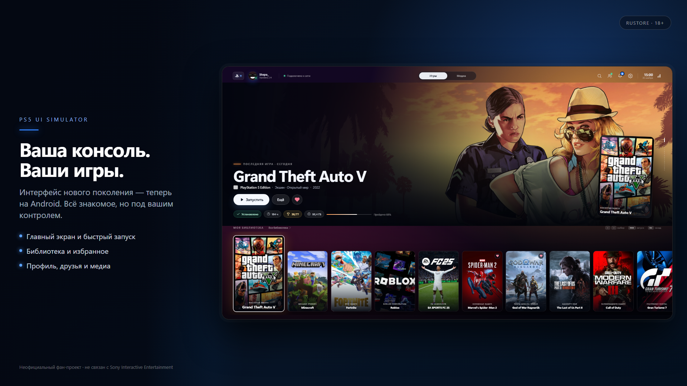

# PS5 UI Simulator

Неофициальный симулятор интерфейса PlayStation 5 в браузере: домашний экран, магазин, библиотека, запуск игр с логотипами студий и загрузкой, менеджер загрузок, Control Center, трофеи и настройки.

Проект — чистый HTML/CSS/JavaScript без фреймворков и зависимостей. Готовый `ps5-os.html` открывается двойным кликом, всё содержимое (обложки, кадры, логотипы) встроено в файл, интернет не нужен.



## Возможности

- **Домашний экран** — лента игр, hero-блок выбранной игры, переключение «Игры/Медиа», навигация стрелками, Enter и геймпадом.
- **Магазин** — каталог с реальными обложками, издания (Standard/Deluxe/Ultimate), скидки с таймерами, вишлист, история покупок, цены в рублях.
- **Библиотека** — установка и удаление, фильтры, статистика (игры, ГБ, время, трофеи), время последнего запуска.
- **Запуск игры** — экран запуска PlayStation с таймером сеанса, логотипы студии и издателя, загрузка, длительность которой зависит от веса и года игры, меню игры и ошибка при попытке начать игру.
- **Менеджер загрузок** — реальная скорость в Мбит/с, ETA, пауза и продолжение, очередь, ускорение симуляции в настройках, докачка после перезагрузки страницы.
- **Control Center** — быстрые действия (загрузки, друзья, вечеринка, музыка, микрофон, уведомления, скриншоты, трофеи), ползунок яркости.
- **Трофеи** — платина/золото/серебро/бронза, прогресс по игре.
- **Настройки** — сеть и скорость загрузки, внешний вид и обои, звуки интерфейса, геймпад, хранилище.
- **Профиль, друзья, вечеринка, медиа** — приглашения, лента активности, мини-плеер с запоминанием прогресса.


## Запуск

1. Открой `ps5-os.html` в Chrome, Edge или Safari (актуальная версия).
2. Для навигации: стрелки, Enter, Esc; `S` — поиск, `P` — меню PlayStation, `M` — переключение «Игры/Медиа».
3. Геймпад (DualSense, DualShock, Xbox): стик или крестовина — навигация, ×/A — выбор, ○/B — назад, Start — меню PlayStation.

Состояние (библиотека, покупки, загрузки, настройки) хранится в `localStorage` браузера.

## Структура

```
ps5-os.html            готовый собранный файл (всё встроено)
src/index.html         каркас страницы
src/css/               стили: boot, home, views, real, downloads, extras, gameboot
src/js/                логика: state, system, home, views, store2, downloads, extras, gameboot
src/assets/            обложки, кадры, логотипы, аватары
docs/                  скриншоты для README
android/               Android-обёртка (WebView) для сборки APK
```

Сборка: все ресурсы (стили, скрипты, обложки, логотипы) встраиваются в один HTML-файл — готовый `ps5-os.html` лежит в корне репозитория.

## Авторы

- **XPRODC** — автор проекта.
- **Cloud** — участие в разработке.

## Лицензия

Исходный код распространяется по лицензии MIT — см. [LICENSE](LICENSE).

Сторонние материалы (обложки игр, кадры, логотипы студий и издателей, товарные знаки) лицензией MIT не покрываются — см. [NOTICE](NOTICE).

## Дисклеймер

Проект неофициальный и не связан с Sony Interactive Entertainment. PlayStation, PS5, DualSense и соответствующие логотипы — товарные знаки Sony Interactive Entertainment. Названия игр, обложки, кадры и логотипы принадлежат их правообладателям и используются исключительно в демонстрационных целях.
